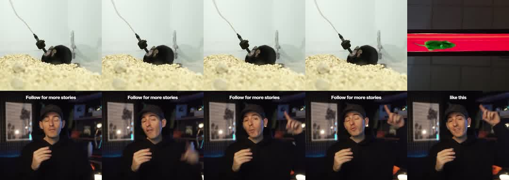

# v01_s49 · 14 Título - cierre - CTA · 84.8–85.4s (calidad 3)

- **Guion:** Fall for more stories
- **Qué se ve:** Arriba: ratón con cable en la viruta. Subtítulo 'Follow for more stories'.
- **Diseño:** Pantalla dividida 50/50 con b-roll arriba y él abajo; subtítulo pequeño blanco sans bold en y≈54 % con el llamado a la acción dicho.
- **Efectos:** Sin texturas.
- **Animación:** Corte seco arriba cada ~0.6 s.
- **Por qué aquí:** CTA dicho sin gráfico de 'follow': solo subtítulo y b-roll.
