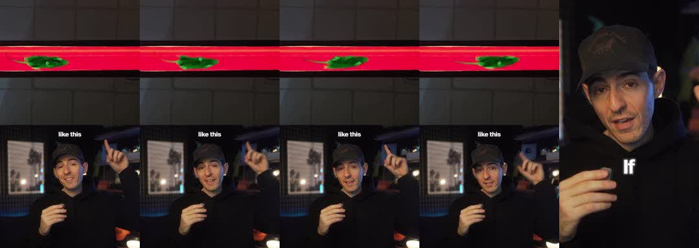

# v01_s50 · 14 Título - cierre - CTA · 85.4–86.0s (calidad 3)

- **Guion:** like this if
- **Qué se ve:** Arriba: tubo rojo con un ratón verde (imagen térmica o filtrada). Subtítulo 'like this'.
- **Diseño:** Pantalla dividida 50/50 con b-roll arriba y él abajo; subtítulo pequeño blanco sans bold en y≈54 % con el llamado a la acción dicho.
- **Efectos:** Sin texturas.
- **Animación:** Corte seco arriba cada ~0.6 s.
- **Por qué aquí:** Imagen rara para retener en el CTA.
