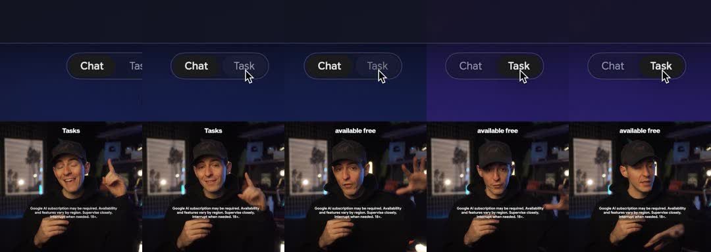

# v02_s56 · 14 Título - cierre - CTA · 84.4–86.0s (calidad 4)

- **Guion:** tasks is now available free to
- **Qué se ve:** Arriba: conmutador 'Chat | Task' con cursor haciendo clic en Task. Subtítulo 'Tasks' / 'is now' / 'available free'. Aviso legal sobre él.
- **Diseño:** Pantalla dividida 50/50: arriba el conmutador 'Chat | Task' ampliado con cursor; abajo él. Subtítulo pequeño en y≈54 % y aviso legal pequeño en y≈71 %.
- **Efectos:** Sin texturas.
- **Animación:** Corte seco; el cursor hace clic en 'Task'.
- **Por qué aquí:** Cierra con la misma imagen del gancho: el botón que hay que tocar.
