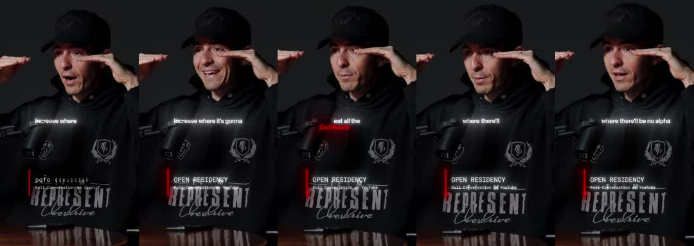

# v03_s09 · 14 Título - cierre - CTA · 31.9–35.4s (calidad 3)

- **Guion:** it's gonna eat all the fact -based formats where there'll be no alpha and
- **Qué se ve:** Mismo primer plano; aparece el tercio inferior 'OPEN RESIDENCY / Full Conversation on YouTube'. Subtítulo 'increase where it's gonna' → 'eat all the' + 'fact-based formats' (rojo) → 'where there'll be no alpha'.
- **Diseño:** Mismo primer plano de él; se añade un tercio inferior a la izquierda en y≈72–76 %: barra vertical roja + 'OPEN RESIDENCY' en monoespaciada mayúsculas blanca y debajo 'Full Conversation on YouTube' más pequeña. Subtítulo acumulativo en y≈49 %.
- **Efectos:** Igual que el A-roll: desaturado, glow en textos.
- **Animación:** El tercio inferior entra con efecto de letras aleatorias que se resuelven (scramble) en ≈0.4 s; la barra roja aparece primero.
- **Por qué aquí:** El CTA va como tercio inferior discreto sin interrumpir el discurso.
