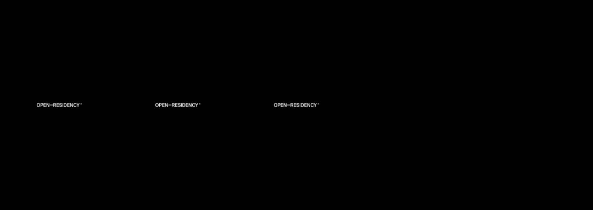

# v04_s25 · 14 Título - cierre - CTA · 34.7–39.0s (calidad 3)

- **Guion:** 
- **Qué se ve:** El plano se vela a blanco y cae a negro con 'OPEN—RESIDENCY°' pequeño centrado (34.83–37.12); 2 fotogramas blancos a 37.16 y negro hasta 39.0.
- **Diseño:** Pantalla negra con 'OPEN—RESIDENCY°' en sans blanca muy pequeña (≈1 % del alto), centrada en x=50 %, y≈50 %.
- **Efectos:** Negro puro; destello blanco al entrar y otro al final.
- **Animación:** El plano anterior se vela a blanco en ≈4 fotogramas (34.66–34.78) y cae a negro con el logotipo ya puesto; a 37.16 hay 2 fotogramas blancos y vuelve a negro hasta el final.
- **Por qué aquí:** Cierre de marca del podcast, sin texto de llamada a la acción.
