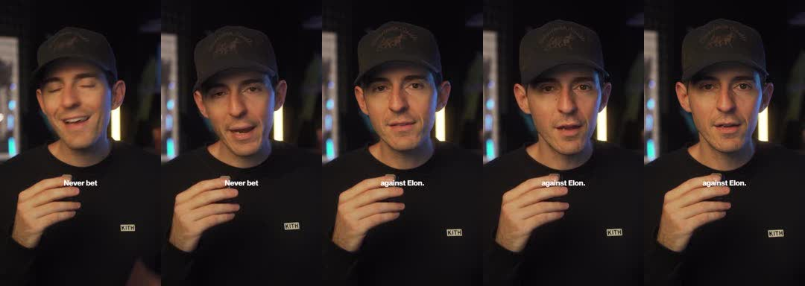

# v05_s39 · 14 Título - cierre - CTA · 82.7–84.0s (calidad 3)

- **Guion:** Never bet against Elon.
- **Qué se ve:** Su cara a pantalla completa, sonríe con los ojos cerrados y luego mira a cámara; subtítulo pequeño «Never bet», «against Elon.».
- **Diseño:** Subtítulo pequeño blanco sans bold, y≈64 %; sin logo, sin botón, sin texto de CTA
- **Efectos:** Set oscuro con luces prácticas cian y ámbar desenfocadas; sin textura añadida visible
- **Animación:** Corte seco desde la tarjeta; termina en corte (sin fundido visible)
- **Por qué aquí:** Cierre con frase-sentencia en vez de CTA: remata con la cara, sin pedir nada
