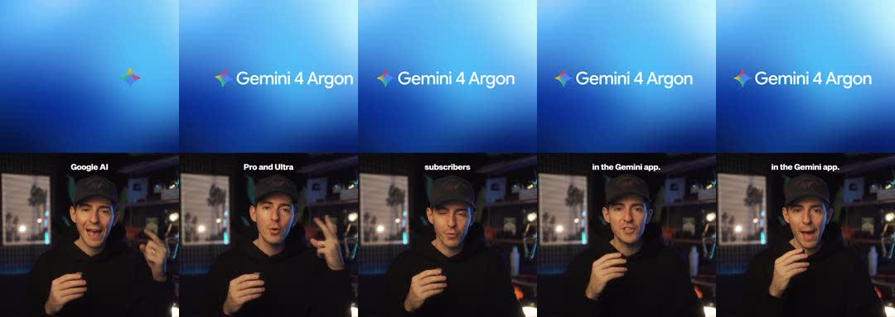

# v06_s43 · 14 Título - cierre - CTA · 81.3–84.4s (calidad 3)

- **Guion:** Pro and Ultra Subscribers in the Gemini app.
- **Qué se ve:** Pantalla dividida. Arriba: fondo azul degradado con el logotipo «✦ Gemini 4 Argon» que entra. Abajo él diciendo dónde está disponible.
- **Diseño:** Logo blanco sans regular con estrella de 4 colores, centrado en la mitad superior, sobre azul (#1E6BE0 aprox.). Subtítulo blanco sans bold (tipo Inter), 1–3 palabras, ~30 px sobre 720 (≈2,3 % del alto), centrado, y≈52,7 % (≈58 px bajo la costura, que está en y≈48,1 %); sin caja («Google AI», «Pro and Ultra», «subscribers», «in the Gemini app.»)
- **Efectos:** Set oscuro con luces cian y ámbar desenfocadas; sin textura añadida
- **Animación:** Corte seco; el logo se despliega en ~0,5 s; el video termina por corte (a 84.37 vuelve a empezar)
- **Por qué aquí:** CTA de patrocinio: nombre del producto + dónde conseguirlo, sin botón ni «follow»
