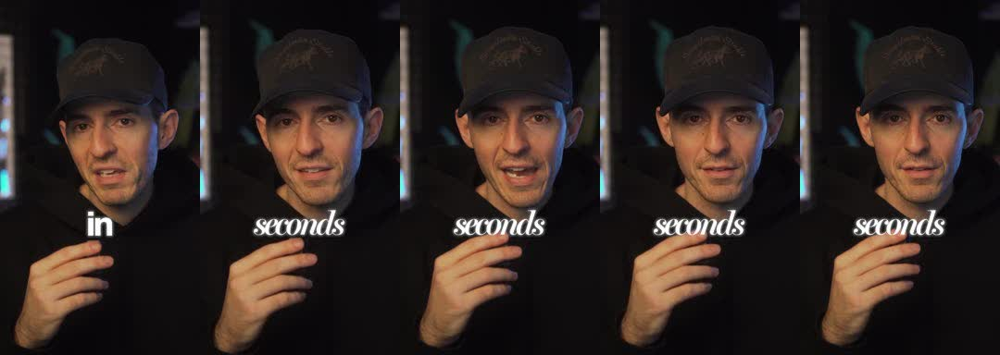

# v07_s40 · 14 Título - cierre - CTA · 79.9–80.8s (calidad 4)

- **Guion:** seconds.
- **Qué se ve:** Cierre: punch-in a su cara con la palabra grande «in» y «seconds» en serif itálica. Sin CTA.
- **Diseño:** Palabra única blanca sans bold ~62 px con glow, centrada, y≈64 %; la palabra clave en serif itálica de alto contraste; cara a pantalla completa. Sin logo, sin botón, sin texto de CTA
- **Efectos:** Glow blanco tras la palabra; set oscuro con prácticos cian/ámbar desenfocados
- **Animación:** Corte seco; «seconds» se sostiene hasta el final; termina en corte
- **Por qué aquí:** Última palabra-promesa a cámara; cierre seco sin pedir nada
