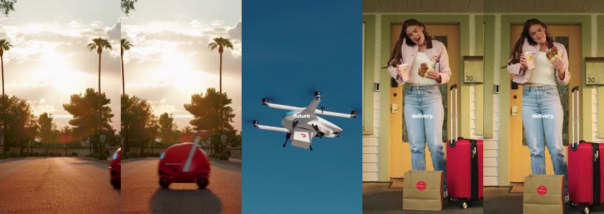

# v08_s38 · 14 Título - cierre - CTA · 95.4–97.8s (calidad 4)

- **Guion:** pioneer the future of delivery.
- **Qué se ve:** Cierre con b-roll a pantalla completa, sin él ni tarjeta: calle al atardecer con un robot (95.39–96.22), dron en cielo azul (96.22–96.93) y mujer con comida en su puerta (96.93–97.85). Subtítulos pequeños «to pioneer», «the», «future», «delivery.». Sin CTA.
- **Diseño:** Subtítulo pequeño blanco sans bold, centrado en x e y≈54 %, con pastilla gris semitransparente redondeada cuando el fondo es claro. Sin logo, sin botón, sin texto de CTA
- **Efectos:** Contraluz dorado en el primer plano
- **Animación:** Cortes secos; termina en corte sobre el último plano
- **Por qué aquí:** Cierre visual (robot, dron, cliente feliz) en lugar de cara: la frase final se ilustra con los 3 protagonistas
