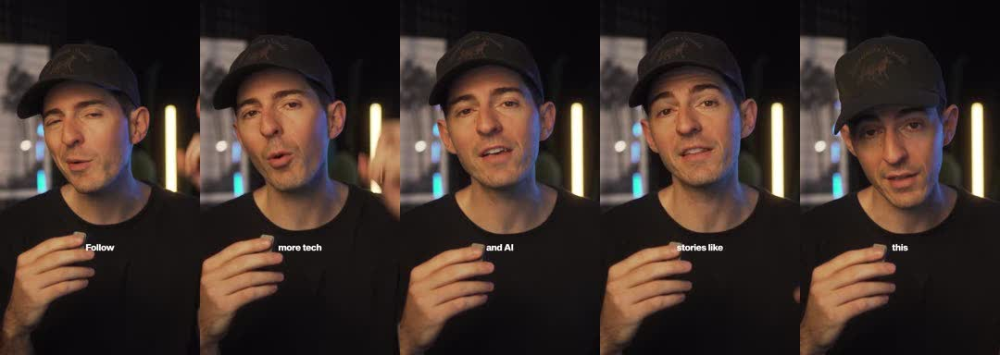

# v09_s32 · 14 Título - cierre - CTA · 69.8–71.9s (calidad 3)

- **Guion:** Follow along for more tech and AI stories like this.
- **Qué se ve:** Cara completa con subtítulo pequeño 'Follow / along for / more tech / and AI / stories like / this'.
- **Diseño:** Cierre: él a pantalla completa (punch-in), solo subtítulo pequeño blanco centrado en y≈66 %; sin botón ni gráfico de CTA.
- **Efectos:** Sin grano, papel ni halftone añadidos. A-roll: set oscuro, viñeta natural, prácticos cálidos y tubo/luz cian al fondo. 
- **Animación:** Corte seco de entrada; termina por corte al final del clip (sin fundido observado).
- **Por qué aquí:** CTA hablado y sobrio: sin gráfico, solo la cara.
