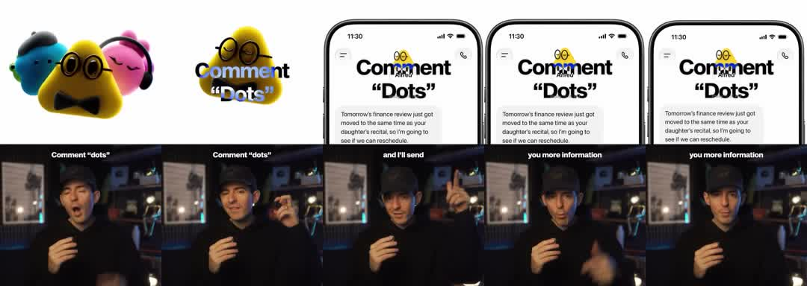

# v10_s52 · 14 Título - cierre - CTA · 120.8–122.1s (calidad 4)

- **Guion:** Comment dots and I'll send you more information
- **Qué se ve:** CTA: arriba las mascotas con el texto negro enorme 'Comment “Dots”' encima, que se convierte en el móvil con el mismo texto; abajo él con 'Comment “dots” / and I'll send / you more information'.
- **Diseño:** Split 50/50. Texto CTA: sans grotesca bold NEGRA ≈90 px de alto, 2 líneas ('Comment' / '“Dots”' con comillas tipográficas), centrado sobre la mascota/móvil (y≈8–22 %). Subtítulo blanco pequeño bajo la costura repite 'Comment “dots”'.
- **Efectos:** Sin grano, papel ni halftone añadidos. A-roll: set oscuro, viñeta natural, prácticos cálidos y tubo/luz cian al fondo. 
- **Animación:** Corte seco de entrada; termina por corte al final del clip (sin fundido observado).
- **Por qué aquí:** CTA de comentario con palabra clave: reutiliza el plano del gancho (mascotas) → cierre circular.
