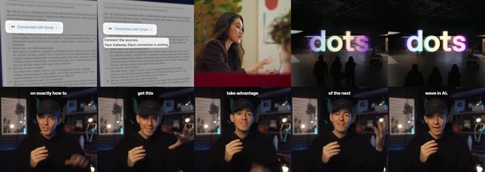

# v10_s53 · 14 Título - cierre - CTA · 122.1–126.4s (calidad 3)

- **Guion:** on exactly how to get this set up so that you can take advantage of the next wave in AI.
- **Qué se ve:** Cierre: arriba recapitulación (documento con pastillas 'Connected with Gmail', mujer gesticulando, plató oscuro con logo 'dots' arcoíris).
- **Diseño:** Split 50/50, mismos planos ya vistos como recapitulación. Subtítulo pequeño blanco bajo la costura.
- **Efectos:** Sin grano, papel ni halftone añadidos. A-roll: set oscuro, viñeta natural, prácticos cálidos y tubo/luz cian al fondo. 
- **Animación:** Corte seco de entrada; termina por corte al final del clip (sin fundido observado).
- **Por qué aquí:** Promesa del CTA + último plano = logo del gancho: abre y cierra con la misma imagen.
