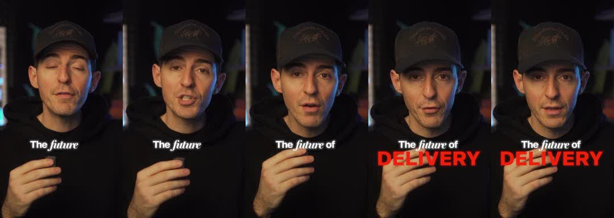

# v11_s33 · 14 Título - cierre - CTA · 90.6–92.2s (calidad 5)

- **Guion:** future of delivery.
- **Qué se ve:** Cierre: cara completa con el rótulo 'The future of' (sans + 'future' en serif itálica) y debajo 'DELIVERY' en rojo, mayúsculas extendidas, con glow. Sin CTA explícito.
- **Diseño:** Él a pantalla completa. Rótulo final en 2 líneas centrado en y≈63–69 %: 'The' y 'of' en sans bold blanca ≈40 px, 'future' en serif itálica blanca; segunda línea 'DELIVERY' en sans extendida ultra-bold roja (≈#EB1700) ≈62 px con halo rojo.
- **Efectos:** Glow rojo alrededor de 'DELIVERY'; halo blanco suave en la primera línea; fondo del set desenfocado.
- **Animación:** Corte seco a cara; el rótulo se construye palabra a palabra con la voz ('The' 90.6 → 'future' 90.7 → 'of' ≈91.2 → 'DELIVERY' ≈91.5) y se queda hasta el final.
- **Por qué aquí:** Frase-tesis como rótulo final con el rojo de marca; repite 'future' en itálica del segundo 8.5 → cierre circular, sin pedir nada.
