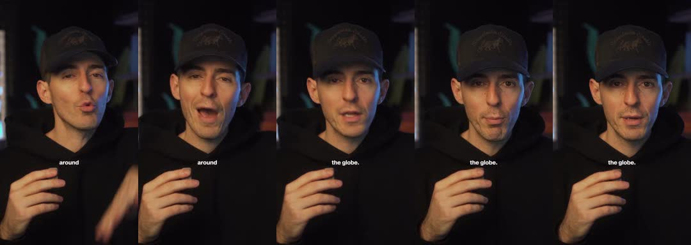

# v12_s31 · 14 Título - cierre - CTA · 75.0–76.2s (calidad 3)

- **Guion:** the globe.
- **Qué se ve:** Cierre: cara completa con subtítulo pequeño 'around / the globe.' Sin CTA ni gráfico.
- **Diseño:** Él a pantalla completa (punch-in), solo subtítulo pequeño blanco centrado en y≈65 %. No hay texto de CTA, logo ni botón.
- **Efectos:** Sin grano, papel ni halftone añadidos. A-roll: set oscuro, viñeta natural, prácticos cálidos y tubo/luz cian al fondo. 
- **Animación:** Corte seco de entrada; termina por corte al final del clip (sin fundido observado).
- **Por qué aquí:** Termina en la predicción, seco: 1.1 s de cara y fin (favorece el loop).
