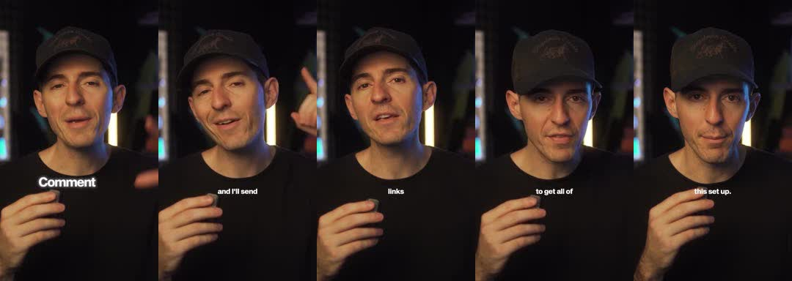

# v13_s53 · 14 Título - cierre - CTA · 116.3–119.4s (calidad 4)

- **Guion:** Gemini and I'll send through the links to get all of this set up.
- **Qué se ve:** Cara a pantalla completa. 116,29–116,96 s: «Comment» + «“Gemini”» en grande; después subtítulos pequeños «and I'll send», «through the», «links», «to get all of», «this set up.».
- **Diseño:** Punch-in de cara a pantalla completa. CTA en 2 líneas alineado a la izquierda-centro, y≈820–900 px: «Comment» sans bold blanca (~55 px) y debajo «“Gemini”» en serif itálica didona blanca (~95 px) con comillas tipográficas.
- **Efectos:** Glow blanco suave en el texto del CTA.
- **Animación:** El CTA aparece por corte y dura ~0,7 s; luego vuelve el subtítulo pequeño. Final por corte a negro/fin.
- **Por qué aquí:** CTA de comentario con palabra clave (automatización de DM): la palabra a escribir va en serif itálica y entre comillas.
