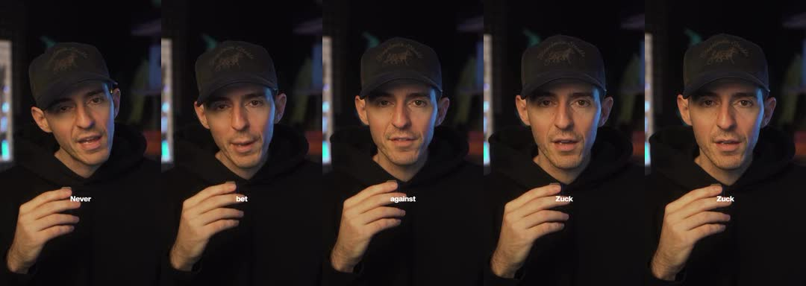

# v14_s71 · 14 Título - cierre - CTA · 120.3–121.4s (calidad 4)

- **Guion:** Never bet against Zuck.
- **Qué se ve:** Cara a pantalla completa con una palabra pequeña por corte: «Never», «bet», «against», «Zuck».
- **Diseño:** Punch-in de cara a pantalla completa con subtítulo pequeño de UNA palabra (~30 px) en y≈890 px.
- **Efectos:** Sin efectos.
- **Animación:** Una palabra por corte; el video termina en seco tras la última palabra.
- **Por qué aquí:** Frase lapidaria de cierre en vez de CTA: termina en seco para favorecer el bucle de reproducción.
