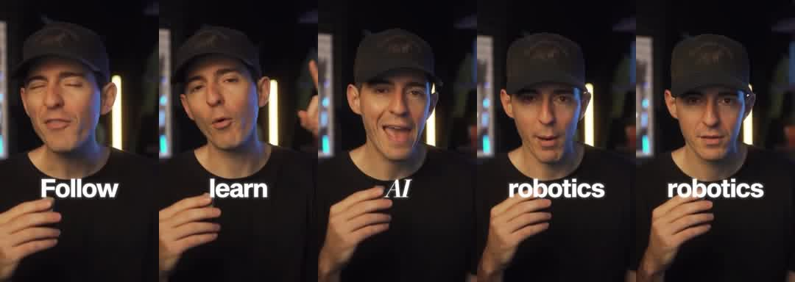

# v18_s28 · 14 Título - cierre - CTA · 58.6–61.3s (calidad 3)

- **Guion:** Follow if you want to learn more about tech, AI and robotics.
- **Qué se ve:** Cara completa con palabras grandes: «Follow if you want to learn more about tech, AI(serif itálica) and robotics».
- **Diseño:** Cierre sobre su cara a pantalla completa con palabras grandes blancas (mismo sistema que face_full_word); sin tarjeta final, sin logo ni botón.
- **Efectos:** Glow blanco suave en la palabra; fondo desenfocado.
- **Animación:** Corte seco de entrada; palabra por palabra por pop seco; el video termina en corte (sin fade observado).
- **Por qué aquí:** CTA hablado y escrito palabra a palabra sobre su cara: sin tarjeta final, el «Follow» es la primera palabra gigante.
