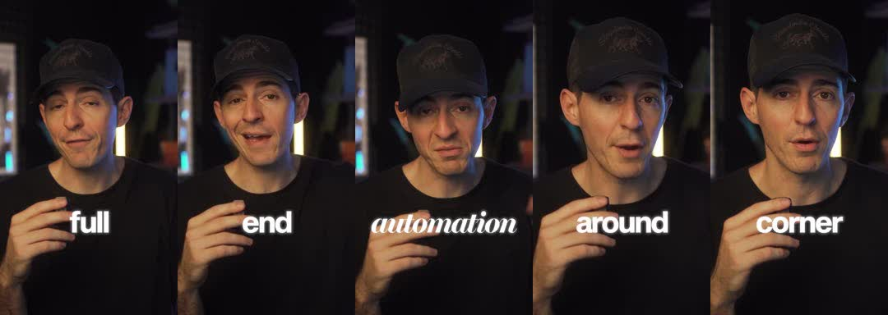

# v20_s38 · 14 Título - cierre - CTA · 80.8–83.7s (calidad 4)

- **Guion:** And full end to end automation is right around the corner.
- **Qué se ve:** Cara completa con palabras grandes: «And full end to end automation(serif itálica) is right around the corner».
- **Diseño:** Cierre sobre su cara a pantalla completa con palabras grandes blancas (mismo sistema que face_full_word); sin tarjeta final, sin logo ni botón.
- **Efectos:** Glow blanco suave en la palabra; fondo desenfocado.
- **Animación:** Corte seco de entrada; palabra por palabra por pop seco; el video termina en corte (sin fade observado).
- **Por qué aquí:** Cierre-tesis en cara + palabra gigante; no hay «follow» ni tarjeta final: termina en la frase.
