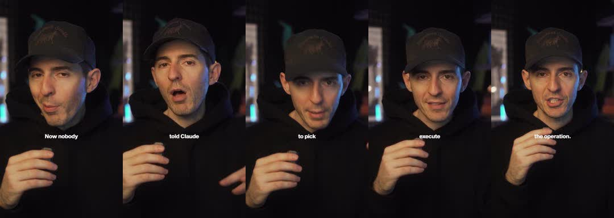

# v01_s18 · 15 A-roll sin texto · 24.4–28.5s (calidad 3)

- **Guion:** Now nobody told Claude what treatment to pick or how to execute the operation.
- **Qué se ve:** Él a pantalla completa, punch-in; subtítulo pequeño: 'Now nobody' / 'told Claude' / 'what treatment' / 'to pick' / 'or how to' / 'execute' / 'the operation.'.
- **Diseño:** Él a pantalla completa en punch-in (mismo encuadre que face_full_word) pero con el subtítulo PEQUEÑO: blanco, sans bold, 1–3 palabras, centrado, y≈62–65 % (sobre el pecho), altura ≈22 px.
- **Efectos:** Sin texturas; set oscuro con bokeh.
- **Animación:** Corte seco desde la pantalla dividida (salto de escala del A-roll ≈ ×2). Subtítulo por sustitución seca.
- **Por qué aquí:** Punto de tensión ('nadie le dijo…'): quita la evidencia para que mires la cara.
