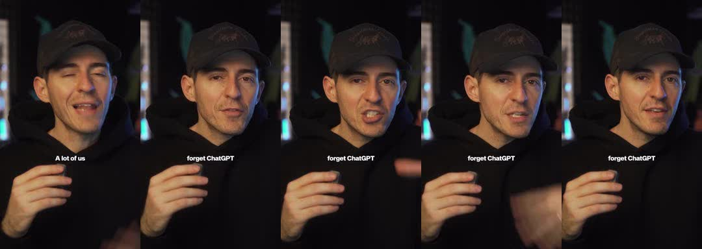

# v01_s37 · 15 A-roll sin texto · 66.0–67.2s (calidad 3)

- **Guion:** A lot of us forget, chatGPT came
- **Qué se ve:** Él a pantalla completa; subtítulo pequeño 'A lot of us' / 'forget ChatGPT'.
- **Diseño:** Él a pantalla completa en punch-in (mismo encuadre que face_full_word) pero con el subtítulo PEQUEÑO: blanco, sans bold, 1–3 palabras, centrado, y≈62–65 % (sobre el pecho), altura ≈22 px.
- **Efectos:** Sin texturas; set oscuro con bokeh.
- **Animación:** Corte seco desde la pantalla dividida (salto de escala del A-roll ≈ ×2). Subtítulo por sustitución seca.
- **Por qué aquí:** Nueva idea (comparación temporal): cara.
