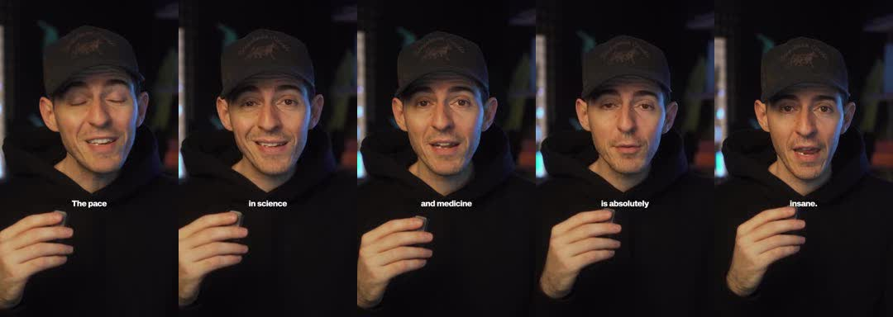

# v01_s44 · 15 A-roll sin texto · 74.0–76.8s (calidad 3)

- **Guion:** The pace of progress in science and medicine is absolutely insane.
- **Qué se ve:** Él a pantalla completa; subtítulo pequeño 'of progress' / 'in science' / 'and medicine' / 'is absolutely' / 'insane.'.
- **Diseño:** Él a pantalla completa en punch-in (mismo encuadre que face_full_word) pero con el subtítulo PEQUEÑO: blanco, sans bold, 1–3 palabras, centrado, y≈62–65 % (sobre el pecho), altura ≈22 px.
- **Efectos:** Sin texturas; set oscuro con bokeh.
- **Animación:** Corte seco desde la pantalla dividida (salto de escala del A-roll ≈ ×2). Subtítulo por sustitución seca.
- **Por qué aquí:** Opinión fuerte: cara.
