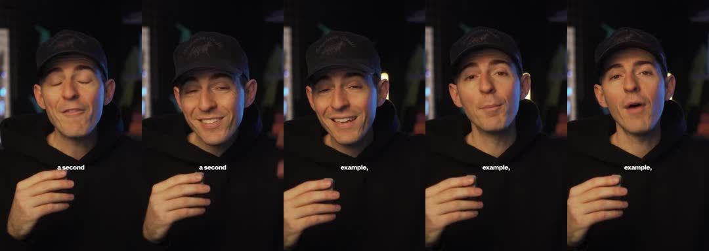

# v02_s40 · 15 A-roll sin texto · 57.5–58.4s (calidad 3)

- **Guion:** for a second example,
- **Qué se ve:** Él a pantalla completa; subtítulo pequeño 'a second' / 'example,'.
- **Diseño:** Él a pantalla completa en punch-in con subtítulo PEQUEÑO blanco sans bold (1–3 palabras) en y≈62–66 %.
- **Efectos:** Sin texturas; set oscuro con bokeh.
- **Animación:** Corte seco; subtítulo por sustitución seca.
- **Por qué aquí:** Marca el ejemplo 2 con cara (aquí sin palabra grande).
