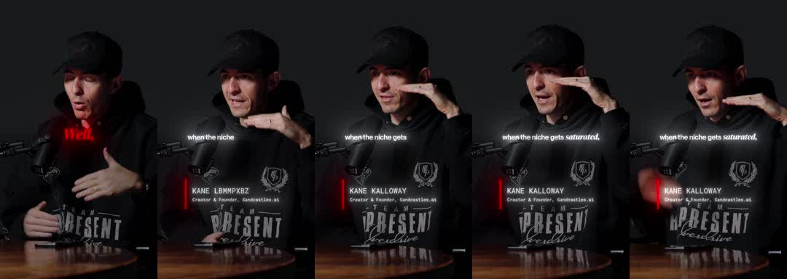

# v03_s02 · 15 A-roll sin texto · 1.8–3.7s (calidad 4)

- **Guion:** Well, when the niche gets saturated,
- **Qué se ve:** Primer plano de él con la mano plana a la altura de la cara. 'Well,' aparece en rojo con glow; luego 'when the niche gets saturated,' ('saturated,' en serif itálica). Tercio inferior 'KANE KALLOWAY / Creator & Founder, Sandcastles.ai' con barra roja vertical.
- **Diseño:** Él a pantalla completa (cámara de podcast; gorra y sudadera negras con letras 'REPRESENT', micrófono a la izquierda, fondo gris oscuro liso). Subtítulo ACUMULATIVO (las palabras se van sumando hasta completar la frase, 1–2 líneas, hasta ~8 palabras): sans grotesca regular/medium blanca pequeña (≈20–24 px sobre 1280) con halo blanco suave; la palabra o frase clave cambia a serif itálica bold ROJA (#E0101E aprox.) con glow rojo intenso. Posición del subtítulo: centrado, y≈49–50 % (sobre el pecho, bajo el mentón). Tercio inferior a la izquierda en y≈66–73 %: barra vertical roja, 'KANE KALLOWAY' en monoespaciada mayúsculas blanca y 'Creator & Founder, Sandcastles.ai' más pequeña (así está escrito en pantalla).
- **Efectos:** Imagen desaturada, casi monocroma gris, contraste alto, viñeta; glow blanco en el texto y rojo en la palabra clave.
- **Animación:** Corte seco. El nombre entra con letras aleatorias que se resuelven (a 2.0 s se lee 'KANE QGRRUCSE', a 2.5 s 'KANE KALLOWAY'). 'Well,' entra en rojo con glow y se va antes de la frase.
- **Por qué aquí:** Presenta a quien habla en el primer corte a cara: identifica al invitado.
