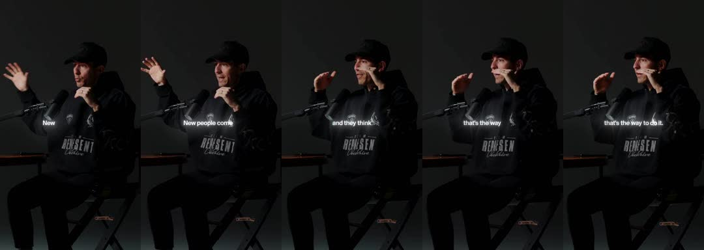

# v03_s06 · 15 A-roll sin texto · 21.7–24.6s (calidad 3)

- **Guion:** New people come in and they think that's the way to do it. They're
- **Qué se ve:** Plano medio lateral (cámara B). Subtítulo 'New people come in' → 'and they think' → 'that's the way to do it.'.
- **Diseño:** Él a pantalla completa (cámara de podcast; gorra y sudadera negras con letras 'REPRESENT', micrófono a la izquierda, fondo gris oscuro liso). Subtítulo ACUMULATIVO (las palabras se van sumando hasta completar la frase, 1–2 líneas, hasta ~8 palabras): sans grotesca regular/medium blanca pequeña (≈20–24 px sobre 1280) con halo blanco suave; la palabra o frase clave cambia a serif itálica bold ROJA (#E0101E aprox.) con glow rojo intenso. Posición del subtítulo: centrado, y≈49–50 % (sobre el pecho, bajo el mentón).
- **Efectos:** Imagen desaturada, casi monocroma gris, contraste alto, viñeta; glow blanco en el texto y rojo en la palabra clave.
- **Animación:** Corte seco entre cámaras (A: primer plano frontal; B: plano medio lateral desde su derecha). El subtítulo se escribe palabra a palabra (cada palabra entra con leve fundido); al terminar la frase se borra y empieza la siguiente.
- **Por qué aquí:** Alterna cámara cada frase para mantener ritmo sin b-roll.
