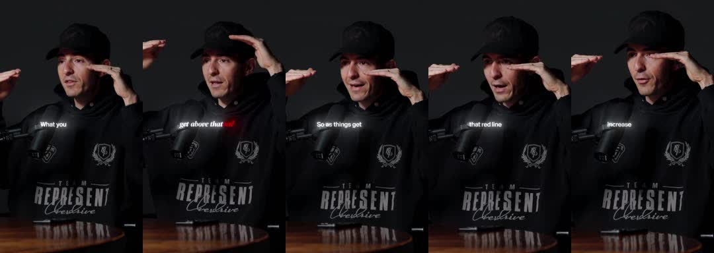

# v03_s08 · 15 A-roll sin texto · 26.6–31.9s (calidad 3)

- **Guion:** you need to do is get above that red line. So as things get competitive, that red line will slowly increase where
- **Qué se ve:** Primer plano (cámara A), mano sobre la frente como visera. Subtítulo 'What you need to do is' → 'get above that red line.' ('red' en rojo) → 'So as things get competitive,' → 'that red line will slowly' → 'increase'.
- **Diseño:** Él a pantalla completa (cámara de podcast; gorra y sudadera negras con letras 'REPRESENT', micrófono a la izquierda, fondo gris oscuro liso). Subtítulo ACUMULATIVO (las palabras se van sumando hasta completar la frase, 1–2 líneas, hasta ~8 palabras): sans grotesca regular/medium blanca pequeña (≈20–24 px sobre 1280) con halo blanco suave; la palabra o frase clave cambia a serif itálica bold ROJA (#E0101E aprox.) con glow rojo intenso. Posición del subtítulo: centrado, y≈49–50 % (sobre el pecho, bajo el mentón).
- **Efectos:** Imagen desaturada, casi monocroma gris, contraste alto, viñeta; glow blanco en el texto y rojo en la palabra clave.
- **Animación:** Corte seco entre cámaras (A: primer plano frontal; B: plano medio lateral desde su derecha). El subtítulo se escribe palabra a palabra (cada palabra entra con leve fundido); al terminar la frase se borra y empieza la siguiente.
- **Por qué aquí:** La solución ('ponte por encima') se dice a cámara; solo 'red' va en rojo.
