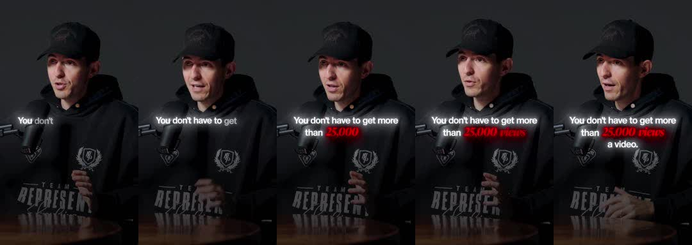

# v04_s02 · 15 A-roll sin texto · 2.3–4.4s (calidad 4)

- **Guion:** You don't have to get more than 25 ,000 views a video.
- **Qué se ve:** Primer plano frontal de él. Subtítulo que crece: 'You don't have to get more than' + '25,000 views' (serif itálica roja) + 'a video.'.
- **Diseño:** Él a pantalla completa (podcast: gorra y sudadera negras 'REPRESENT', micrófono, fondo gris oscuro) o plano general de siluetas cuando solo lleva texto. Subtítulo ACUMULATIVO por frase (crece palabra a palabra, 1–3 líneas centradas): sans grotesca medium blanca con halo, tamaño medio (≈34–38 px sobre 1280 en primeros planos, ≈22 px en el plano general); la cifra o frase clave en serif itálica bold ROJA (#E0101E aprox.) con glow rojo. Posición: y≈49–58 % en planos de él; y≈33–38 % (por encima de las siluetas) en el plano general.
- **Efectos:** Imagen desaturada casi B/N, contraste alto, viñeta; glow blanco en texto y rojo en la clave.
- **Animación:** Corte seco entre cámaras (A primer plano frontal, B medio lateral, general de siluetas). Texto por write-on de palabra; las palabras rojas entran como mancha roja borrosa que se enfoca.
- **Por qué aquí:** Respuesta directa a cámara; la cifra en rojo es lo único de color.
