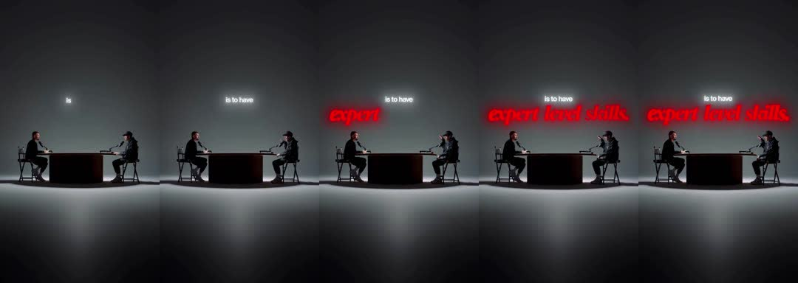

# v04_s12 · 15 A-roll sin texto · 15.7–18.0s (calidad 5)

- **Guion:** to have expert level skills.
- **Qué se ve:** Plano general de siluetas. Texto arriba: 'is to have' (blanco pequeño) y debajo 'expert level skills.' en serif itálica roja grande con glow, que se escribe palabra a palabra.
- **Diseño:** Él a pantalla completa (podcast: gorra y sudadera negras 'REPRESENT', micrófono, fondo gris oscuro) o plano general de siluetas cuando solo lleva texto. Subtítulo ACUMULATIVO por frase (crece palabra a palabra, 1–3 líneas centradas): sans grotesca medium blanca con halo, tamaño medio (≈34–38 px sobre 1280 en primeros planos, ≈22 px en el plano general); la cifra o frase clave en serif itálica bold ROJA (#E0101E aprox.) con glow rojo. Posición: y≈49–58 % en planos de él; y≈33–38 % (por encima de las siluetas) en el plano general.
- **Efectos:** Imagen desaturada casi B/N, contraste alto, viñeta; glow blanco en texto y rojo en la clave.
- **Animación:** Corte seco entre cámaras (A primer plano frontal, B medio lateral, general de siluetas). Texto por write-on de palabra; las palabras rojas entran como mancha roja borrosa que se enfoca.
- **Por qué aquí:** La tesis central va en el plano con más espacio negativo para que el rojo domine.
