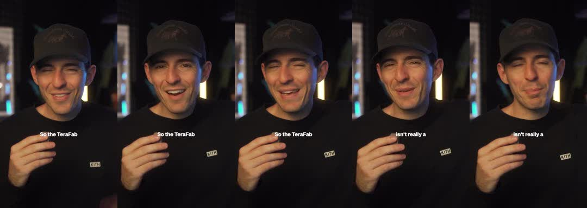

# v05_s20 · 15 A-roll sin texto · 39.6–41.0s (calidad 3)

- **Guion:** So the TerraFab isn't really a
- **Qué se ve:** Su cara a pantalla completa, sonriendo; subtítulo pequeño «So the TeraFab», «isn't really a».
- **Diseño:** Subtítulo pequeño blanco sans bold (mismo tamaño que en dividida), centrado, y≈64–66 % (sobre el pecho)
- **Efectos:** Set oscuro con luces prácticas cian y ámbar desenfocadas; sin textura añadida visible
- **Animación:** Corte seco de entrada y salida (1 fotograma)
- **Por qué aquí:** Reencuadre de la tesis («isn't really a play…»): cara sin palabra grande = pausa de ritmo
