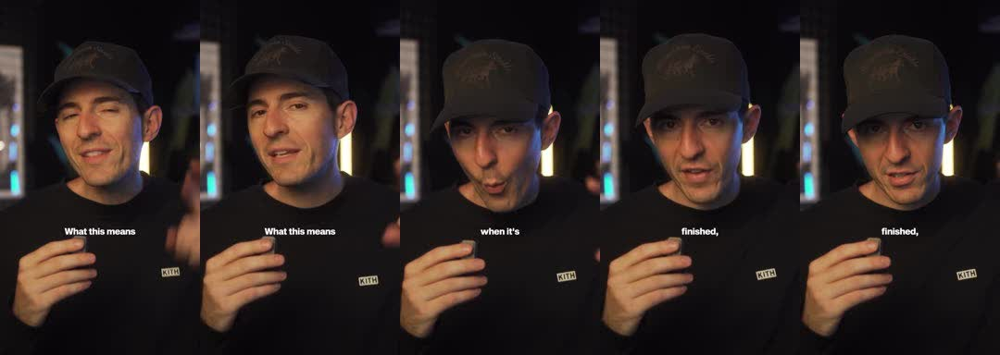

# v05_s24 · 15 A-roll sin texto · 48.0–49.6s (calidad 3)

- **Guion:** What this means is that when it's finished,
- **Qué se ve:** Cara a pantalla completa, subtítulos pequeños «What this means», «is that», «when it's», «finished,».
- **Diseño:** Subtítulo pequeño blanco, y≈65 %
- **Efectos:** Set oscuro con luces prácticas cian y ámbar desenfocadas; sin textura añadida visible
- **Animación:** Corte seco de entrada y salida (1 fotograma)
- **Por qué aquí:** Frase bisagra («What this means is…») → cara: anuncia la conclusión
