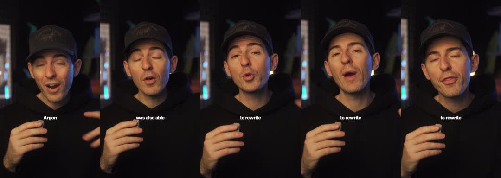

# v06_s36 · 15 A-roll sin texto · 64.0–65.6s (calidad 3)

- **Guion:** Argonne was also able to rewrite 32
- **Qué se ve:** Cara a pantalla completa con subtítulo pequeño «Argon», «was also able», «to rewrite».
- **Diseño:** Subtítulo pequeño blanco, y≈66 %
- **Efectos:** Set oscuro con luces cian y ámbar desenfocadas; sin textura añadida
- **Animación:** Corte seco de entrada y salida (1 fotograma)
- **Por qué aquí:** Segundo dato duro: misma fórmula (cara → fuente)
