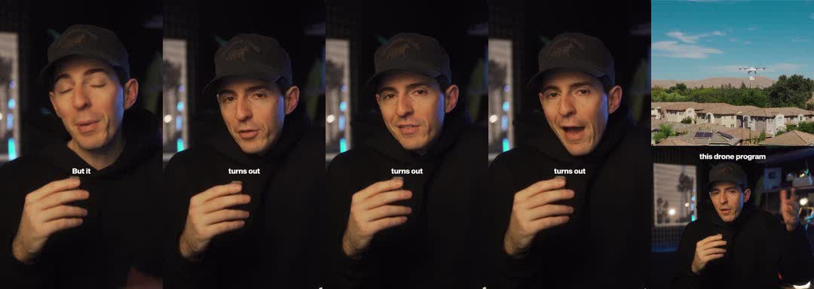

# v08_s09 · 15 A-roll sin texto · 21.3–21.9s (calidad 3)

- **Guion:** it turns out this
- **Qué se ve:** Cara a pantalla completa con subtítulo pequeño «But it», «turns out».
- **Diseño:** Subtítulo pequeño blanco sans bold, centrado, y≈65 % (sobre el pecho)
- **Efectos:** Set oscuro con luces cian y ámbar desenfocadas; sin textura añadida
- **Animación:** Corte seco de entrada y salida (1 fotograma)
- **Por qué aquí:** Giro («But it turns out») → 0,7 s de cara
