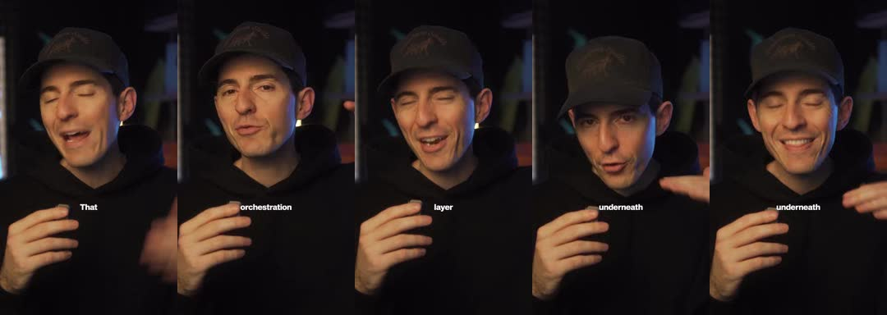

# v08_s32 · 15 A-roll sin texto · 82.1–83.6s (calidad 3)

- **Guion:** That orchestration layer underneath is
- **Qué se ve:** Cara a pantalla completa con subtítulo pequeño «That», «orchestration», «underneath».
- **Diseño:** Subtítulo pequeño blanco sans bold, centrado, y≈65 % (sobre el pecho)
- **Efectos:** Set oscuro con luces cian y ámbar desenfocadas; sin textura añadida
- **Animación:** Corte seco de entrada y salida (1 fotograma)
- **Por qué aquí:** Repite el concepto de la cita («orchestration layer») con su propia voz
