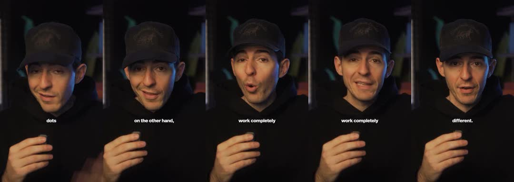

# v10_s19 · 15 A-roll sin texto · 36.7–38.9s (calidad 2)

- **Guion:** Dots, on the other hand, work completely different.
- **Qué se ve:** Cara completa con subtítulo 'dots / on the other hand, / work completely / different.'
- **Diseño:** Él a pantalla completa en punch-in (mismo encuadre que face_full_word) pero solo con el subtítulo pequeño blanco (≈30 px) centrado en y≈63–67 %, 1–3 palabras; sin palabra grande.
- **Efectos:** Sin grano, papel ni halftone añadidos. A-roll: set oscuro, viñeta natural, prácticos cálidos y tubo/luz cian al fondo. Fondo desenfocado; subtítulo con sombra mínima.
- **Animación:** Entra y sale por corte seco; el subtítulo pequeño se sustituye cada 1–3 palabras. Sin movimiento de cámara añadido apreciable.
- **Por qué aquí:** Contraste: vuelve a cara para pasar al otro lado de la comparación.
