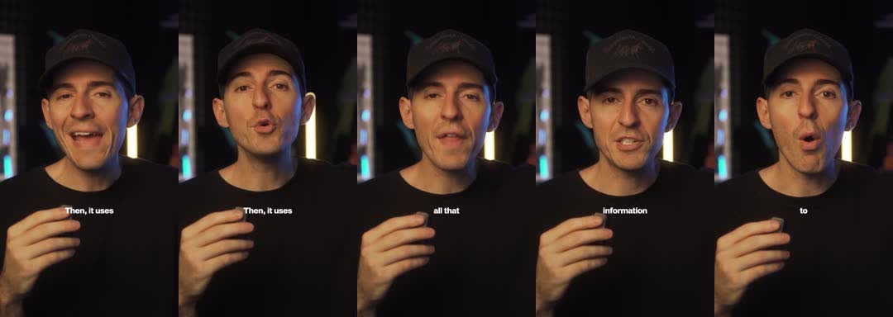

# v13_s24 · 15 A-roll sin texto · 46.0–47.9s (calidad 2)

- **Guion:** Then it uses all that information to
- **Qué se ve:** Cara a pantalla completa con subtítulo pequeño «Then, it uses», «all that», «information», «to».
- **Diseño:** Punch-in de su cara a pantalla completa con subtítulo PEQUEÑO (mismo estilo que en el split, ~30 px) centrado en y≈760–850 px (59–66 %), sobre el pecho.
- **Efectos:** Sin efectos añadidos.
- **Animación:** Corte seco de entrada y salida; subtítulo por corte cada 0,4–0,8 s. Sin zoom apreciable.
- **Por qué aquí:** Respiro y conector («entonces…») antes del siguiente paso del proceso.
