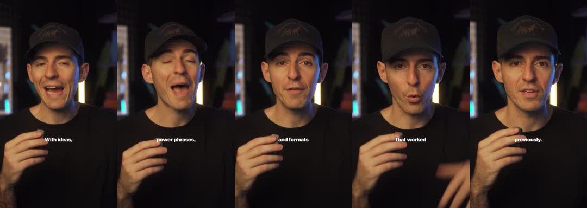

# v13_s26 · 15 A-roll sin texto · 53.2–56.5s (calidad 2)

- **Guion:** with ideas, power phrases, and formats that worked previously.
- **Qué se ve:** Cara a pantalla completa con subtítulos pequeños «With ideas,», «power phrases,», «and formats», «that worked», «previously.».
- **Diseño:** Punch-in de su cara a pantalla completa con subtítulo PEQUEÑO (mismo estilo que en el split, ~30 px) centrado en y≈760–850 px (59–66 %), sobre el pecho.
- **Efectos:** Sin efectos añadidos.
- **Animación:** Corte seco de entrada y salida; subtítulo por corte cada 0,4–0,8 s. Sin zoom apreciable.
- **Por qué aquí:** Lista hablada sin apoyo visual: contacto visual para dar credibilidad antes de enseñar el doc.
