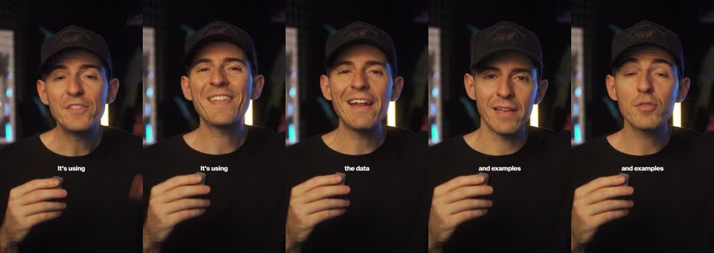

# v13_s31 · 15 A-roll sin texto · 64.0–65.6s (calidad 2)

- **Guion:** It's using the data and examples from
- **Qué se ve:** Cara a pantalla completa, subtítulo pequeño «It's using», «the data», «and examples».
- **Diseño:** Punch-in de su cara a pantalla completa con subtítulo PEQUEÑO (mismo estilo que en el split, ~30 px) centrado en y≈760–850 px (59–66 %), sobre el pecho.
- **Efectos:** Sin efectos añadidos.
- **Animación:** Corte seco de entrada y salida; subtítulo por corte cada 0,4–0,8 s. Sin zoom apreciable.
- **Por qué aquí:** Explica el concepto mirando a cámara.
