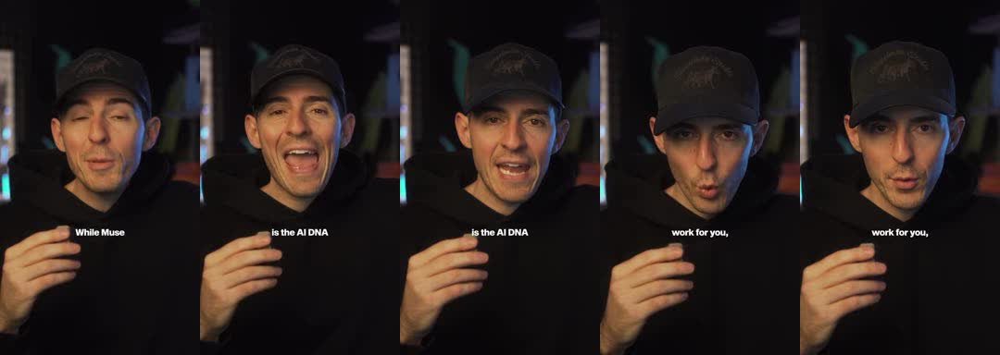

# v14_s33 · 15 A-roll sin texto · 55.2–58.0s (calidad 2)

- **Guion:** Muse is the AI DNA that will do work for you,
- **Qué se ve:** Cara a pantalla completa con subtítulos pequeños «While Muse», «is the AI DNA», «that will do», «work for you,».
- **Diseño:** Punch-in de su cara a pantalla completa con subtítulo PEQUEÑO (~30 px) centrado en y≈840–930 px (66–73 %), sobre el pecho.
- **Efectos:** Sin efectos añadidos.
- **Animación:** Corte seco; subtítulo por corte cada 0,4–0,8 s.
- **Por qué aquí:** Explicación conceptual: mejor cara que imagen.
