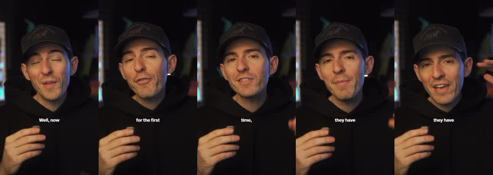

# v14_s59 · 15 A-roll sin texto · 103.5–104.9s (calidad 2)

- **Guion:** Well now for the first time they have
- **Qué se ve:** Cara a pantalla completa con subtítulos pequeños «Well, now», «for the first», «time,», «they have».
- **Diseño:** Punch-in de su cara a pantalla completa con subtítulo PEQUEÑO (~30 px) centrado en y≈840–930 px (66–73 %), sobre el pecho.
- **Efectos:** Sin efectos añadidos.
- **Animación:** Corte seco; subtítulo por corte cada 0,4–0,8 s.
- **Por qué aquí:** Giro («por primera vez»).
