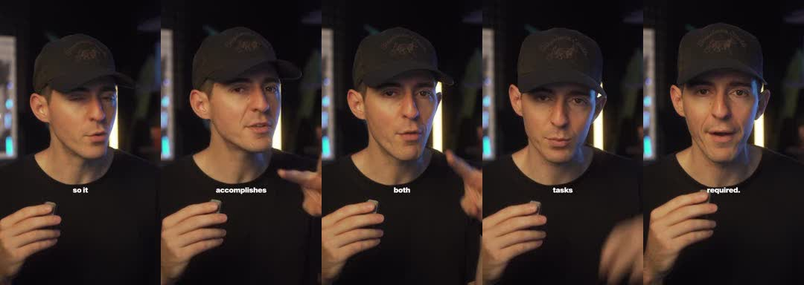

# v16_s35 · 15 A-roll sin texto · 58.0–60.3s (calidad 2)

- **Guion:** so it accomplishes both tasks required.
- **Qué se ve:** Cara a pantalla completa con subtítulos pequeños «so it», «accomplishes», «both», «tasks», «required.».
- **Diseño:** Punch-in de su cara a pantalla completa con subtítulo PEQUEÑO (~30 px) centrado en y≈850–870 px (67 %).
- **Efectos:** Sin efectos añadidos.
- **Animación:** Corte seco; subtítulo por corte cada 0,4–0,8 s.
- **Por qué aquí:** Conclusión del mecanismo.
