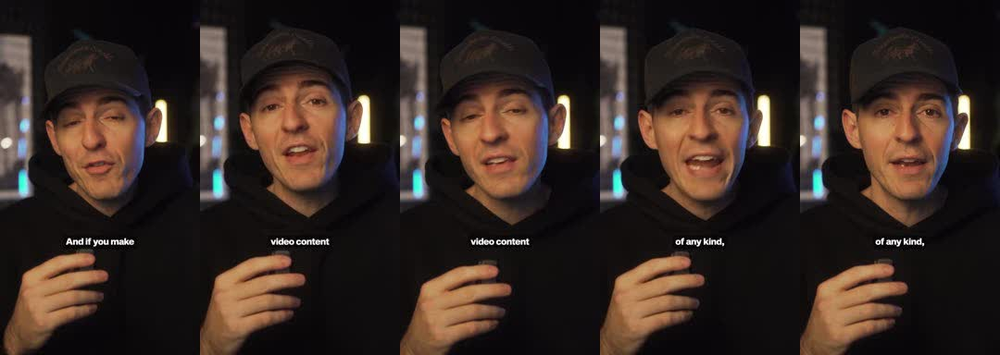

# v17_s03 · 15 A-roll sin texto · 4.2–6.3s (calidad 3)

- **Guion:** And if you make video content of any kind,
- **Qué se ve:** Su cara a pantalla completa (punch-in), sin palabra grande; subtítulo pequeño «And if you make / video content / of any kind,» a la altura del pecho.
- **Diseño:** Su cara a pantalla completa (mismo punch-in que face_full_word) pero SIN palabra grande: solo el subtítulo pequeño blanco (≈30 px, 1–3 palabras) a la altura del pecho (centro y≈66–69 %).
- **Efectos:** Fondo desenfocado del set (luces teal y cálidas); sin grano ni texto destacado.
- **Animación:** Corte seco de entrada y salida; subtítulo cambia por pop seco; sin zoom añadido.
- **Por qué aquí:** Tras el gancho habla directo al espectador («if you make video content»): cara = conexión y descanso visual antes de la siguiente evidencia.
