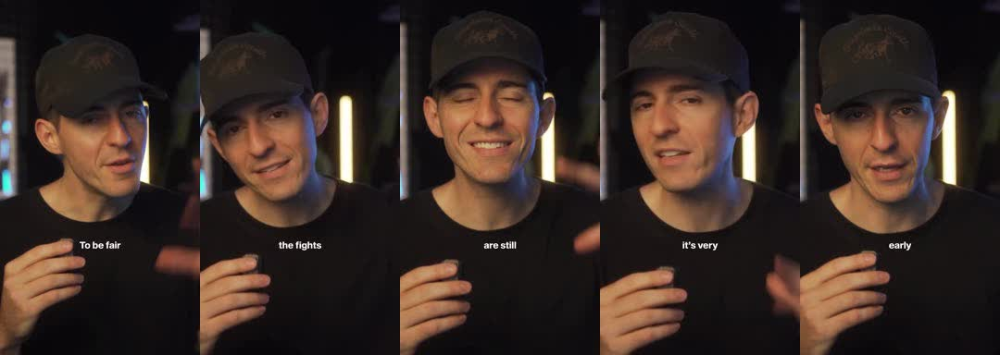

# v18_s21 · 15 A-roll sin texto · 42.0–45.5s (calidad 3)

- **Guion:** be fair, the fights in the league are still pretty clunky. It's very early.
- **Qué se ve:** Cara completa sin palabra grande; subtítulo pequeño «To be fair / the fights / in the league / are still / pretty clunky / it's very / early».
- **Diseño:** Su cara a pantalla completa (mismo punch-in que face_full_word) pero SIN palabra grande: solo el subtítulo pequeño blanco (≈30 px, 1–3 palabras) a la altura del pecho (centro y≈66–69 %).
- **Efectos:** Fondo desenfocado del set (luces teal y cálidas); sin grano ni texto destacado.
- **Animación:** Corte seco de entrada y salida; subtítulo cambia por pop seco; sin zoom añadido.
- **Por qué aquí:** Concesión honesta («to be fair… clunky»): tono más bajo → cara sin palabra grande, 3.6 s de respiro.
