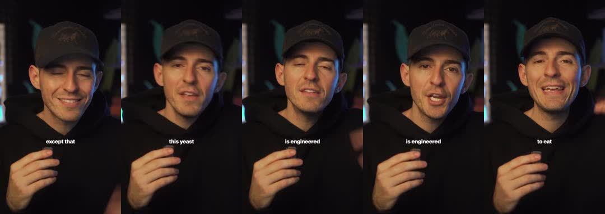

# v19_s21 · 15 A-roll sin texto · 42.4–44.7s (calidad 3)

- **Guion:** except that this yeast is engineered to eat plastic
- **Qué se ve:** Cara completa sin palabra grande; subtítulos «except that / this yeast / is engineered / to eat».
- **Diseño:** Su cara a pantalla completa (mismo punch-in que face_full_word) pero SIN palabra grande: solo el subtítulo pequeño blanco (≈30 px, 1–3 palabras) a la altura del pecho (centro y≈66–69 %).
- **Efectos:** Fondo desenfocado del set (luces teal y cálidas); sin grano ni texto destacado.
- **Animación:** Corte seco de entrada y salida; subtítulo cambia por pop seco; sin zoom añadido.
- **Por qué aquí:** El «except» (la diferencia) en cara: primera mitad de la frase a cámara…
