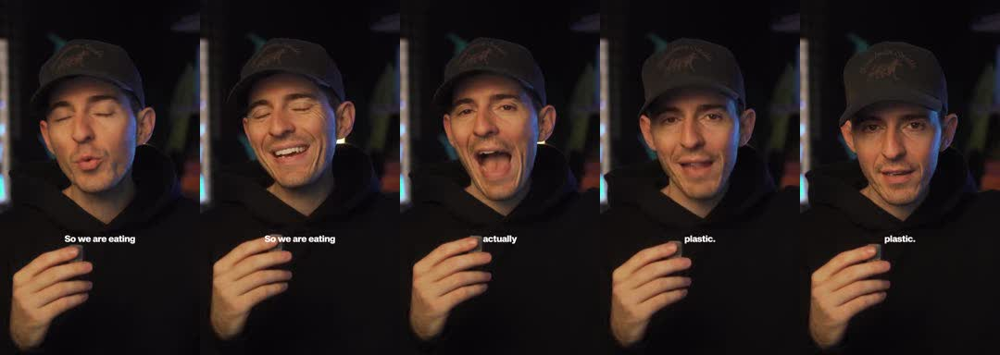

# v19_s29 · 15 A-roll sin texto · 60.4–62.5s (calidad 3)

- **Guion:** So what you're eating is not actually plastic.
- **Qué se ve:** Cara completa; subtítulos «So what you're eating / is not / actually / plastic.»
- **Diseño:** Su cara a pantalla completa (mismo punch-in que face_full_word) pero SIN palabra grande: solo el subtítulo pequeño blanco (≈30 px, 1–3 palabras) a la altura del pecho (centro y≈66–69 %).
- **Efectos:** Fondo desenfocado del set (luces teal y cálidas); sin grano ni texto destacado.
- **Animación:** Corte seco de entrada y salida; subtítulo cambia por pop seco; sin zoom añadido.
- **Por qué aquí:** Aclaración importante (no comes plástico) dicha a cámara: confianza.
