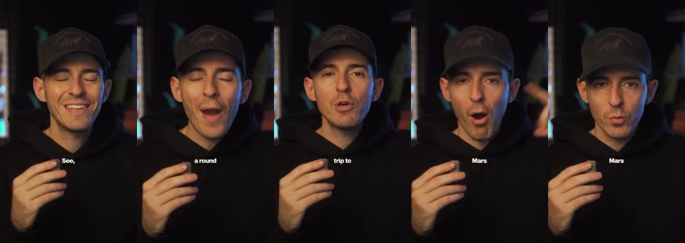

# v19_s33 · 15 A-roll sin texto · 70.5–72.0s (calidad 2)

- **Guion:** See, a round trip to Mars will
- **Qué se ve:** Cara completa; subtítulos «a round / trip to / Mars».
- **Diseño:** Su cara a pantalla completa (mismo punch-in que face_full_word) pero SIN palabra grande: solo el subtítulo pequeño blanco (≈30 px, 1–3 palabras) a la altura del pecho (centro y≈66–69 %).
- **Efectos:** Fondo desenfocado del set (luces teal y cálidas); sin grano ni texto destacado.
- **Animación:** Corte seco de entrada y salida; subtítulo cambia por pop seco; sin zoom añadido.
- **Por qué aquí:** Inicio del argumento en cara.
