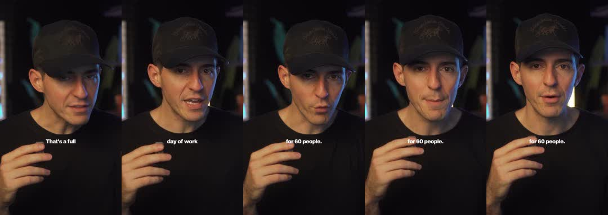

# v20_s33 · 15 A-roll sin texto · 66.0–68.1s (calidad 3)

- **Guion:** That's a full day of work for 60 people.
- **Qué se ve:** Cara completa; subtítulos «That's a full / day of work / for 60 people.»
- **Diseño:** Su cara a pantalla completa (mismo punch-in que face_full_word) pero SIN palabra grande: solo el subtítulo pequeño blanco (≈30 px, 1–3 palabras) a la altura del pecho (centro y≈66–69 %).
- **Efectos:** Fondo desenfocado del set (luces teal y cálidas); sin grano ni texto destacado.
- **Animación:** Corte seco de entrada y salida; subtítulo cambia por pop seco; sin zoom añadido.
- **Por qué aquí:** La comparación humana (60 personas) dicha a cámara, sin palabra grande: tono serio.
