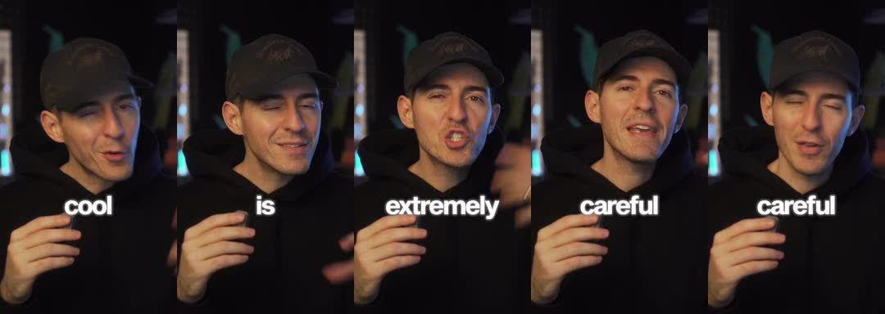

# v01_s30 · face_full_word · 51.9–53.8s (calidad 4)

- **Guion:** And the cool part is it was extremely careful.
- **Qué se ve:** Su cara a pantalla completa; palabras grandes: And, the, cool, part, is, it, was, extremely, careful.
- **Diseño:** Él a pantalla completa en punch-in (cara ocupa ~45 % del ancho, ojos en y≈33 %). UNA palabra a la vez, blanca, sans bold minúsculas, altura ≈60–65 px (≈5 % del alto), centrada en x=50 %, y≈63–64 % (sobre el pecho/mano, bajo el mentón), con halo/glow blanco suave y sombra. Algunas palabras clave cambian a serif itálica de alto contraste (tipo Playfair Display Italic).
- **Efectos:** Glow blanco difuso alrededor de la palabra; fondo del set muy oscuro y desenfocado. Sin grano visible.
- **Animación:** Corte seco al punch-in; cada palabra sustituye a la anterior en seco, sincronizada con la voz (~0.15–0.45 s por palabra). No se aprecia escala ni fade entre palabras a 24 fps.
- **Por qué aquí:** Segunda dosis de cara + palabra grande a los ~48 s del anterior: reinicia atención antes del último tramo.
