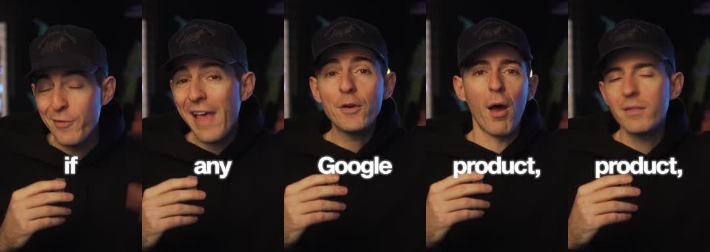

# v02_s03 · face_full_word · 4.5–6.0s (calidad 4)

- **Guion:** If you use any Google product,
- **Qué se ve:** Cara a pantalla completa; palabras grandes: and, if, you, use, any, Google, product,.
- **Diseño:** Él a pantalla completa en punch-in (ojos en y≈33 %). UNA palabra a la vez, blanca, sans bold minúsculas, ≈60–65 px de alto (≈5 %), centrada, y≈63–64 %, con glow blanco suave. Palabras clave en serif itálica de alto contraste ('Tasks', 'powerful').
- **Efectos:** Glow blanco difuso en la palabra; set oscuro con bokeh.
- **Animación:** Corte seco al punch-in; cada palabra sustituye a la anterior en seco (2–7 fotogramas por palabra).
- **Por qué aquí:** Califica a la audiencia ('si usas cualquier producto de Google') mirando a cámara.
