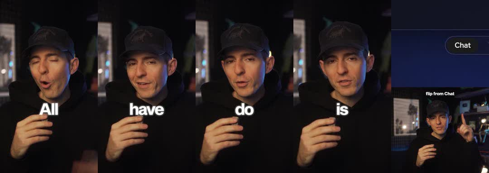

# v02_s11 · face_full_word · 16.5–17.1s (calidad 3)

- **Guion:** All you have to do is
- **Qué se ve:** Cara completa; palabras grandes: All, you, have, to, do, is.
- **Diseño:** Él a pantalla completa en punch-in (ojos en y≈33 %). UNA palabra a la vez, blanca, sans bold minúsculas, ≈60–65 px de alto (≈5 %), centrada, y≈63–64 %, con glow blanco suave. Palabras clave en serif itálica de alto contraste ('Tasks', 'powerful').
- **Efectos:** Glow blanco difuso en la palabra; set oscuro con bokeh.
- **Animación:** Corte seco al punch-in; cada palabra sustituye a la anterior en seco (2–7 fotogramas por palabra).
- **Por qué aquí:** Micro-golpe de 0.6 s para anunciar el paso.
