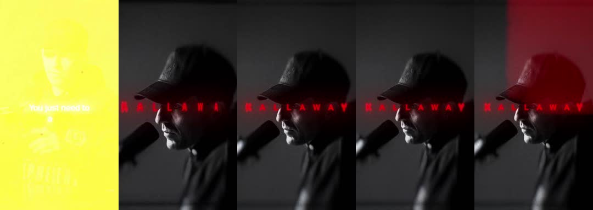

# v04_s05 · face_full_word · 7.2–8.6s (calidad 5)

- **Guion:** Callaway is a creator with
- **Qué se ve:** Estrobo rojo/naranja/amarillo sobre el plano anterior (≈6 fotogramas) y corte a un perfil en B/N desenfocado con el rótulo rojo 'K A L L A W A Y' de lado a lado. Voz de narrador: 'Callaway is a creator with'.
- **Diseño:** Primerísimo plano de perfil de él en blanco y negro, desenfocado, con micrófono; UNA palabra: 'KALLAWAY' en mayúsculas rojas muy espaciadas (tracking amplio, de borde a borde), con glow rojo, centrada en y≈51 % sobre su cara.
- **Efectos:** B/N, desenfoque suave, glow rojo en el rótulo, banda roja translúcida que barre al entrar.
- **Animación:** Entra tras un estrobo rojo/amarillo de ≈6 fotogramas (7.17–7.38); las letras aparecen de izquierda a derecha y el tracking se asienta (7.38–7.6).
- **Por qué aquí:** Tarjeta de presentación del invitado: nombre en grande cuando el narrador lo dice.
