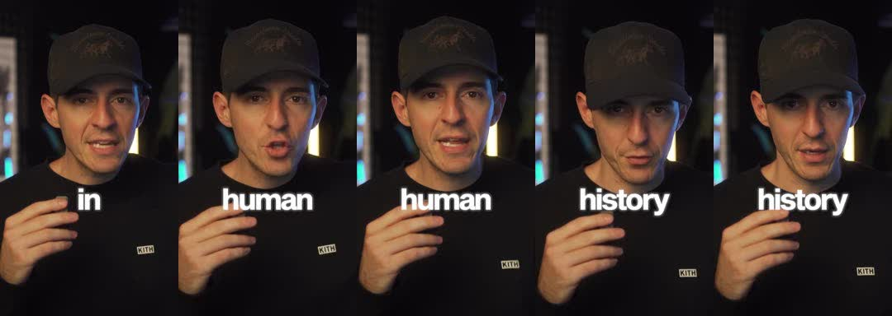

# v05_s02 · face_full_word · 2.5–3.5s (calidad 4)

- **Guion:** human history,
- **Qué se ve:** Punch-in: su cara a pantalla completa. Palabras grandes una a una: «in», «human», «history».
- **Diseño:** Palabra única centrada en x, y≈63 % del alto (sobre el pecho, bajo el mentón), blanca, sans bold ~62 px sobre 720 (≈8 % del ancho por letra alta); la palabra clave cambia a serif itálica de alto contraste (tipo Playfair/Editorial itálica); él ocupa todo el cuadro, ojos en el tercio superior (aquí las tres palabras van en sans bold)
- **Efectos:** Resplandor blanco suave (glow) detrás de la palabra grande; fondo del set oscuro con luces cian/ámbar desenfocadas; sin grano visible
- **Animación:** Corte seco al punch-in; cada palabra sustituye a la anterior por corte al ritmo de la voz (~0,3 s cada una), sin animación de entrada apreciable a 15 fps
- **Por qué aquí:** Cierra la frase del hook mirándote a los ojos: el superlativo «human history» se dice con la cara, no con b-roll
